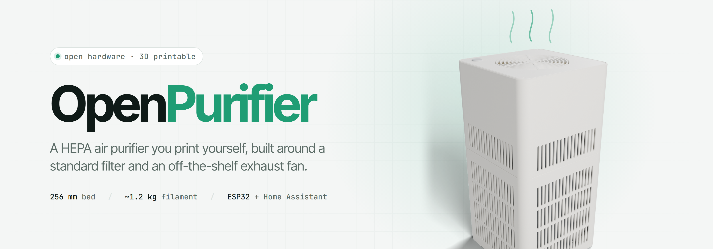
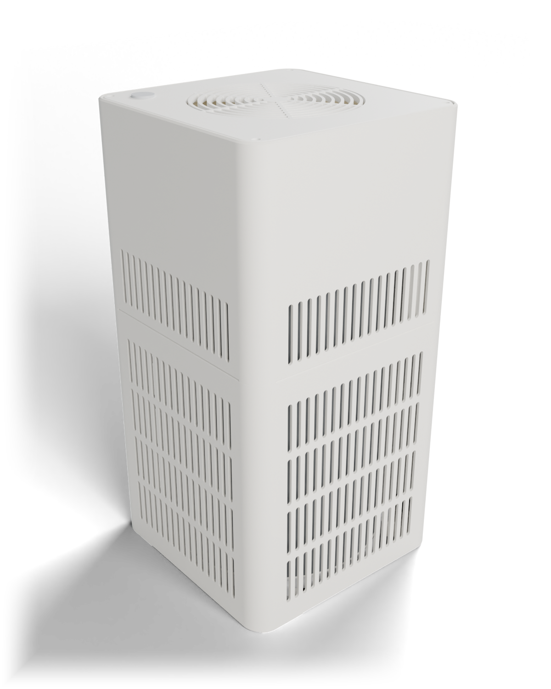
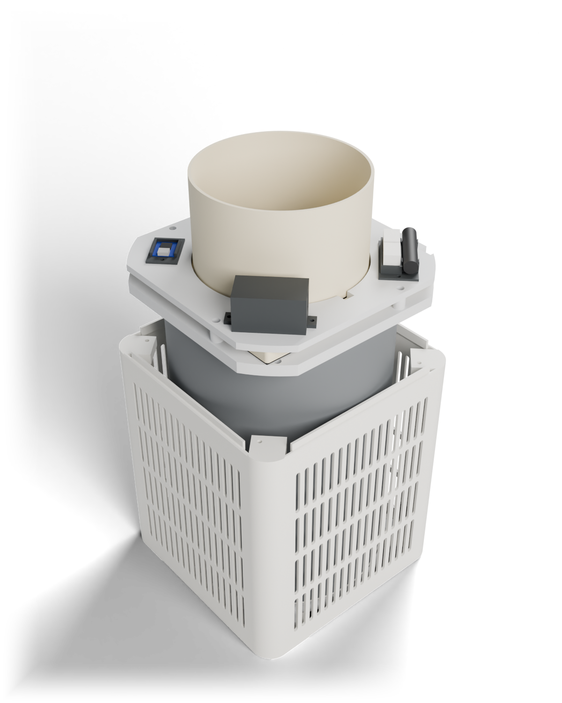
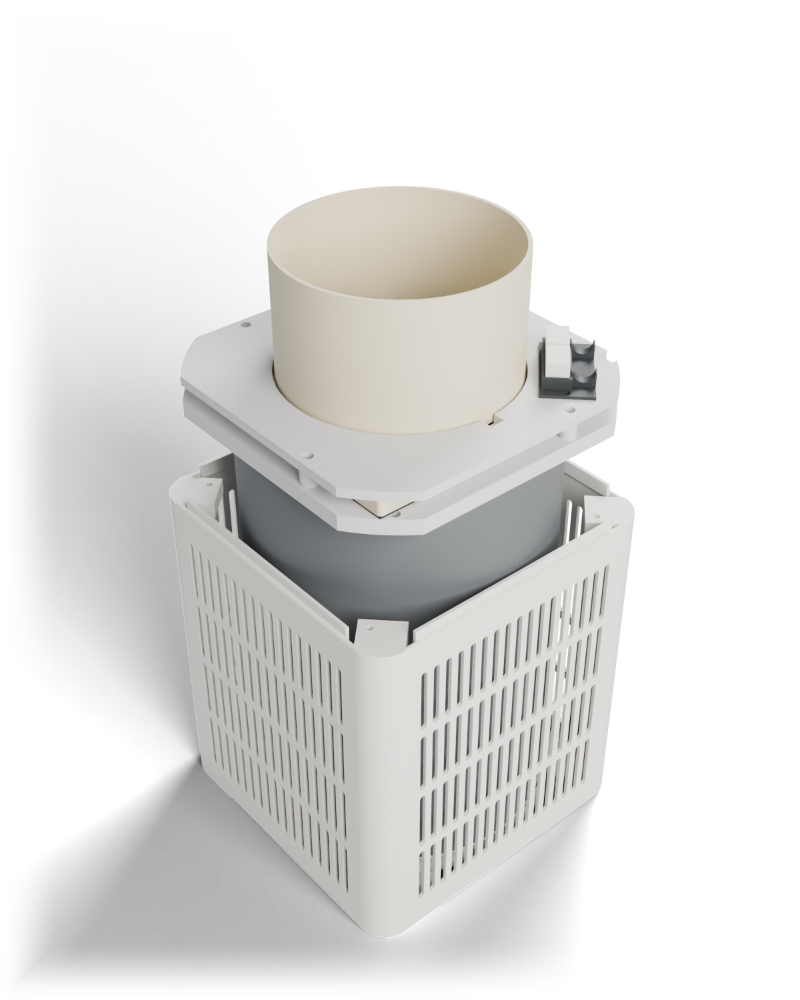
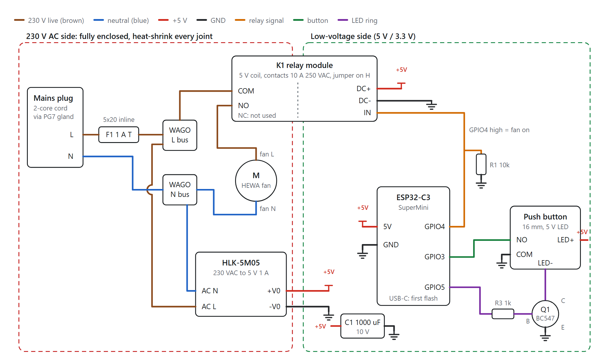

<p align="center">
  
</p>

<p align="center">
  <a href="LICENSE"></a>
  
  
  
  
</p>

<p align="center">
  <a href="#the-two-versions">Versions</a> ·
  <a href="#what-you-need">Parts</a> ·
  <a href="#printing">Printing</a> ·
  <a href="#assembly">Assembly</a> ·
  <a href="#wiring">Wiring</a> ·
  <a href="#firmware">Firmware</a> ·
  <a href="#contributing">Contributing</a>
</p>

---

**OpenPurifier** is a HEPA air purifier you can 3D print at home. It is built around two parts you can
buy almost anywhere: a cylindrical replacement filter made for the Xiaomi Mi Air Purifier, and a
150 mm bathroom exhaust fan. Everything else is printed. All the parts fit a 256 mm bed in one piece,
there are no supports, and the whole thing takes about 1.2 kg of filament.

It started because store-bought purifiers cost a lot more than the parts inside them, and the
filters are locked to one brand. The Xiaomi-style filter is cheap, sold by a dozen clone makers and
easy to find, so the purifier is designed around it instead of the other way round.

There are two versions. The **basic** one is just a filter and a fan in a box: plug it in and it
runs. The **smart** one adds an ESP32 that switches the fan through a relay, a push button with an
LED ring on top, and an [ESPHome](https://esphome.io) config that shows up in Home Assistant with a
filter life counter. They share the same body, so you can start basic and upgrade later by
reprinting three parts.

> [!WARNING]
> Both versions connect to **mains voltage** (230 V in the reference build). If you're not
> comfortable wiring mains, get help from someone who is. Read [Safety](#safety) before you plug
> anything in.

## The two versions

<table>
  <tr>
    <th width="50%">Smart</th>
    <th width="50%">Basic</th>
  </tr>
  <tr>
    <td></td>
    <td></td>
  </tr>
  <tr>
    <td></td>
    <td></td>
  </tr>
  <tr>
    <td>ESP32-C3 + relay + 5 V supply on the deck. Push button with LED ring in the top cap. Home Assistant control, filter-life tracking, remembers its state after a power cut.</td>
    <td>The mains cord meets the fan in two WAGO connectors. No electronics, no firmware. Switch it at the wall socket or with an inline cord switch.</td>
  </tr>
  <tr>
    <td><code>print/smart/</code>: 12 files, ~1.19 kg</td>
    <td><code>print/basic/</code>: 7 files, ~1.16 kg</td>
  </tr>
</table>

<sub>Renders are of the CAD model with the upper body and top cap lifted off in the bottom row.
They're generated from the model by <code>cad/render/render.py</code>, so they always match the STLs.</sub>

## How it works

```
             ↑ ↑ ↑  clean air out through the top grille
        ┌──────────────┐
        │   top cap    │
        │ ┌──────────┐ │  ← fan collar points up
        │ │ HEWA fan │ │  ← front grille faces down, sealed with foam
        │ └──────────┘ │
        │ ════════════ │  ← transition plate
        │ ┌──────────┐ │
  air → │ │  HEPA    │ │ ← air
  in    │ │  filter  │ │   in
        │ │ (hollow) │ │
        │ └──────────┘ │
        │  filter tray │  ← twist-lock, removable from below
        └──────────────┘
```

Room air comes in through the slots in the side walls and goes through the filter from the outside
in. It rises up the filter's hollow core, through the transition plate and into the fan, which
blows it out through the grille in the top cap.

The only seals that matter are two foam rings: one between the filter's top ring and the transition
plate, and one under the fan's front plate. Everything that touches unfiltered air is outside those
seals, so the body itself doesn't need to be airtight. That's why the walls can be slotted and the
two body halves just stack.

### Design notes

- **Square, not round.** A rounded square (216 × 216 mm) prints as two whole sections on a 256 mm
  bed. The earlier cylinder version needed four half-rings; it's kept in [`archive/`](archive/v1-cylinder-servo)
  if you're curious.
- **Unmodified fan.** The fan is clamped by its front plate between the transition plate and the
  deck. You don't cut, drill or open it.
- **Tool-free filter changes.** The filter tray has ears that twist past detent ridges on the
  corner feet. Tip the purifier over, turn the tray, pull the filter out.
- **Relay, not a smart plug.** The ESP32 and the button live inside the purifier, so the button works
  even when Wi-Fi is down.

## Repository layout

```
openpurifier/
├── cad/                  parametric model (build123d, Python)
│   ├── src/              the parts; src/lib/params.py holds every dimension
│   ├── checks/           fit, twist-lock and filament checks
│   └── render/           Blender scripts that make the README renders
├── print/
│   ├── smart/            print-ready STLs for the smart version
│   └── basic/            print-ready STLs for the basic version
├── circuit/              wiring.html: wiring diagram + connection table
├── firmware/             ESPHome config for the ESP32-C3
├── docs/                 images and the banner source
├── reference/            where the dimensions came from (files not included)
└── archive/              v1: the cylinder body with a servo-driven switch
```

## What you need

### Bought parts (both versions)

| Part | What we used | Notes |
| --- | --- | --- |
| HEPA filter | PANCA replacement for Xiaomi Mi Air Purifier 1 / 2 / 2H / 2S / 3 / 3H / 3C | Ø200 × 293 mm, closed bottom end. Any M8R-FLH-type clone should fit |
| Exhaust fan | HEWA Onyx 150 mm (6") | 180 × 180 mm front plate, Ø145 mm collar. Used as-is |
| Mains cord | 2-core with plug, 0.75 mm² | 3-core if your fan has an earth wire |
| Cable gland | PG7 | |
| Foam tape | Soft closed-cell, 10 × 5 mm (~1.2 m) and 6 × 3 mm (~0.7 m) | The seals. Softer is better |
| Screws | M3 × 10 socket head, M3 × 6 socket head | 12 + 12 smart, 12 + 6 basic |
| Heat-set inserts | M3 × 4 brass | 24 smart, 18 basic |
| Connectors | WAGO 221-413 (smart) / 221-412 (basic) | 2 of each |

### Extra parts for the smart version

| Part | Notes |
| --- | --- |
| ESP32-C3 SuperMini | |
| 1-channel 5 V relay module | Optocoupled, with an H/L trigger jumper, contacts rated 10 A 250 VAC, sold as working with 3.3 V logic |
| HLK-5M05 | 230 VAC to 5 V 1 A power module |
| 16 mm momentary push button with 5 V LED ring | |
| Inline 5×20 mm fuse holder + 1 A slow-blow fuse | |
| 1000 µF 10 V capacitor, 10 kΩ and 1 kΩ resistors, BC547 transistor | |
| Jumper wire, heat-shrink, small zip ties | |

## Printing

Every STL is already oriented for printing. No supports.

| Setting | Value |
| --- | --- |
| Material | PETG for the transition plate, deck and anything near the mains parts. PLA is fine for the body, tray and cap |
| Walls | 2 |
| Infill | 15 % |
| Bed | 256 × 256 mm or larger |

<details>
<summary><b>Smart version</b>: <code>print/smart/</code></summary>

| File | Part | Size (mm) |
| --- | --- | --- |
| `01_shell_lower.stl` | Lower body, upright | 216 × 216 × 246 |
| `02_shell_upper.stl` | Upper body, upright | 216 × 216 × 183 |
| `03_tray.stl` | Filter tray | Ø207 × 10 |
| `04_transition_plate.stl` | Transition plate, top face down | 208 × 208 × 10 |
| `05_deck.stl` | Deck, top face down (posts up) | 208 × 208 × 17.5 |
| `06_top_cap.stl` | Top cap, grille face down | 209 × 209 × 17 |
| `07_relay_box.stl` · `08_relay_lid.stl` | Relay enclosure | small |
| `09_psu_box.stl` · `10_psu_lid.stl` | HLK-5M05 enclosure | small |
| `11_esp32_holder.stl` | ESP32-C3 holder | small |
| `12_mains_cradle.stl` | WAGO + fuse holder | small |

Parts 07 to 12 fit on one plate.
</details>

<details>
<summary><b>Basic version</b>: <code>print/basic/</code></summary>

| File | Part |
| --- | --- |
| `01` to `04` | Lower body, upper body, filter tray, transition plate: identical to the smart version |
| `05_deck_basic.stl` | Deck with only the WAGO holder's inserts, top face down |
| `06_top_cap_basic.stl` | Top cap without the button hole, grille face down |
| `07_mains_cradle.stl` | WAGO holder |
</details>

### Measure before you print

Clone parts vary. These are the dimensions the design depends on that I couldn't confirm from a
datasheet. Measure yours, change the value in [`cad/src/lib/params.py`](cad/src/lib/params.py) and
re-export (see [Changing the design](#changing-the-design)).

| Parameter | Default | What it affects |
| --- | --- | --- |
| `FAN_PLATE_T` | 10 | Fan front plate + grille thickness. The deck posts are 11.5 mm: thicker and the deck won't sit down, thinner and it won't clamp |
| `FAN_PLATE`, `FAN_PLATE_CORNER_R` | 180, 3 | The plate sits between four deck posts with 2.5 mm each side |
| `FAN_COLLAR_OD` | 145 | Deck hole and cap duct are Ø148 |
| `FILTER_D`, `FILTER_H` | 200, 293 | The body leaves 5.5 mm around the filter |
| Filter top ring | – | The foam seal lands at Ø172 to 194 mm, so the ring's flat face has to cover that band |
| `INSERT_HOLE_D` | 4.0 | Suits inserts with a 4.5 to 5 mm knurl |
| `RELAY_PCB`, `RELAY_H` | 50 × 26, 17 | Your relay module's board size and height |

## Assembly

1. **Inserts.** Heat-set all the brass inserts.
2. **Body.** Stand the upper body on the lower one; the spigot locates it. Drive 4 × M3 × 10 down
   through the wells in the upper body's corner columns with a long 2.5 mm hex driver.
3. **Transition plate.** Stick the 10 × 5 foam ring into the filter seat on the plate's underside.
   Lower the plate in from the top until it sits on the corner columns and screw it down (4 × M3 × 10).
4. **Fan.** Run the 6 × 3 foam strip around the opening on the plate, set the fan face-down on it
   and put the deck over the collar. Clamp it with 4 × M3 × 10 through the deck posts.
5. **Electrics.** Feed the cord in through the PG7 gland in the back wall, zip-tie it to the anchors
   up the back wall and through the notches in the plate and deck.
   - *Smart:* mount the ESP32 holder, relay box, PSU box and mains cradle (8 × M3 × 6), wire
     everything as in [Wiring](#wiring), set the relay's jumper to **H** and fit both box lids.
   - *Basic:* mount the WAGO holder (2 × M3 × 6) and join cord to fan (see below).
6. **Top cap.** *Smart:* flash the ESP32 over USB **with mains unplugged** first. Fit the cap
   (4 × M3 × 6). The button goes in the front-left corner.
7. **Filter.** Tip the purifier over and slide the filter in from below until it meets the plate's
   seat. Put the second 10 × 5 foam ring on the tray's rim, offer the tray up with its ears beside the
   corner feet, push up about 2 mm and turn it clockwise (seen from below) until the ears click over
   the ridges and hit the stops.

To change the filter, do step 7 in reverse.

## Wiring

### Smart version

<p align="center">
  
</p>

The full diagram with the connection table is in [`circuit/wiring.html`](circuit/wiring.html); open it
in a browser. In short:

| From | To |
| --- | --- |
| Plug L (brown) | 1 A fuse → WAGO L bus → HLK AC L and relay COM |
| Relay NO | Fan L. NC stays empty |
| Plug N (blue) | WAGO N bus → HLK AC N and fan N |
| HLK +5 V | ESP32 5V, relay DC+, button LED+, C1 + |
| HLK GND | ESP32 GND, relay DC−, button COM, Q1 emitter, C1 −, R1 |
| GPIO4 | Relay IN, with R1 (10 kΩ) to GND so the relay stays off while the ESP32 boots |
| GPIO3 | Button NO (internal pull-up, pressed = low) |
| GPIO5 | R3 (1 kΩ) to Q1 base; Q1 collector to button LED− |

### Basic version

Cord brown (L) and the fan's live wire into one WAGO, cord blue (N) and the fan's neutral into the
other. Push both WAGOs into the holder and zip-tie the cord in its saddles. If your fan has a
green/yellow earth wire, use a 3-core cord and join the earths in a third WAGO.

## Firmware

The smart version runs [ESPHome](https://esphome.io). The config is in
[`firmware/openpurifier.yaml`](firmware/openpurifier.yaml).

```bash
cd firmware
cp secrets.example.yaml secrets.yaml     # then put your Wi-Fi name and password in it
esphome run openpurifier.yaml            # first time over USB, after that over Wi-Fi
```

`secrets.yaml` is git-ignored, so your Wi-Fi password stays on your machine. If the ESP32 can't
reach your network it starts an `OpenPurifier Setup` hotspot with a captive portal.

**On the purifier**

| Action | Result |
| --- | --- |
| Short press | Fan on / off. The LED ring shows the state |
| Hold 5 s | New filter fitted: resets the filter timer (LED blinks 3 times) |

**In Home Assistant**

| Entity | Type |
| --- | --- |
| Purifier | Switch |
| Button | Binary sensor |
| Filter used | Sensor, hours |
| Filter life left | Sensor, %. Based on `filter_life_hours` (default 4000 h, about 6 months of 24/7 use) |
| Reset filter timer | Button |

After a power cut it comes back on or off, the way it was.

## Changing the design

The model is plain Python using [build123d](https://github.com/gumyr/build123d), run through
[text-to-cad](https://texttocad.dev)'s `cad` tool. Every dimension lives in
[`cad/src/lib/params.py`](cad/src/lib/params.py), and the parts are built from those values, so a
change there carries through the whole model.

```bash
cd cad
cad run src/assembly.py                       # build both assemblies, prints their ids
PYTHONPATH=src cad run checks/check_fit.py    # interference check, smart version
PYTHONPATH=src cad run checks/check_fit.py basic
PYTHONPATH=src cad run checks/check_tray.py   # twist-lock clearances
PYTHONPATH=src cad run checks/filament.py     # filament estimate
cad run src/print_parts.py                    # every part in print orientation
cad model export <id> ../print/smart/01_shell_lower.stl
```

To regenerate the README renders, export each assembly to `cad/render/out/smart.glb` and
`cad/render/out/basic.glb`, then run `cad run cad/render/render.py <smart|basic> <hero|open> --final`
followed by `python cad/render/fade_edges.py docs/images/render_*.png`. The banner is
[`docs/banner/banner.html`](docs/banner/banner.html), captured at 1600 × 560.

## Safety

- The mains side runs at 230 V. Every joint goes into a WAGO or under heat-shrink.
- Keep the fuse and the cable gland. Fit both box lids on the smart version.
- Never open the purifier or plug in USB while it's connected to mains.
- Test it the first time on a socket protected by an RCD / ELCB.
- PETG near the mains parts, not PLA: PLA softens at temperatures a warm relay or power module can reach.
- This is a hobby project. It isn't certified for anything, and filtration performance depends on
  your filter and how well the seals are fitted.

## Roadmap

- [x] v1: cylinder body with a servo-flipped switch (archived)
- [x] v2: rounded-square body, relay switching, basic version
- [ ] First full print and fit check against real parts
- [ ] Measure airflow and noise, compare filter brands
- [ ] Auto mode with a PMS5003 particle sensor (pins are already reserved: GPIO20 / GPIO21)
- [ ] Adapters for other common fans (120 mm and 200 mm)
- [ ] 110 V notes for North America

## Contributing

Builds, photos, measurements and fixes are all welcome. If you print one, please open an issue with
what fit, what didn't and which filter and fan you used; that's the most useful thing right now.
See [CONTRIBUTING.md](CONTRIBUTING.md) for the details.

## License

[MIT](LICENSE). Do what you like with it, including selling purifiers you build from it. A link back
is appreciated.

The filter and fan are named only to say what the design fits. OpenPurifier isn't affiliated with
Xiaomi, PANCA or HEWA.
